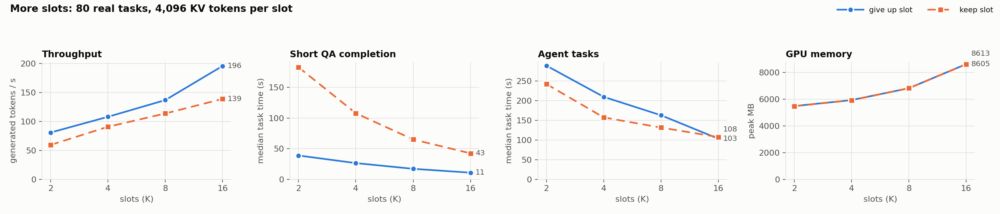
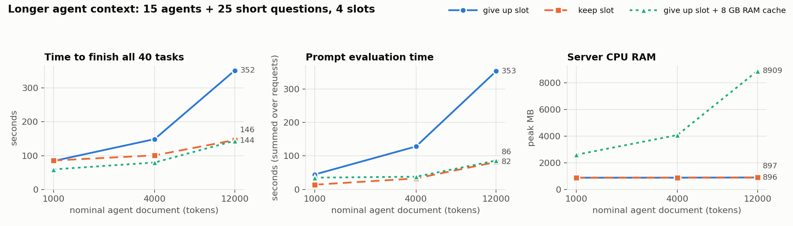
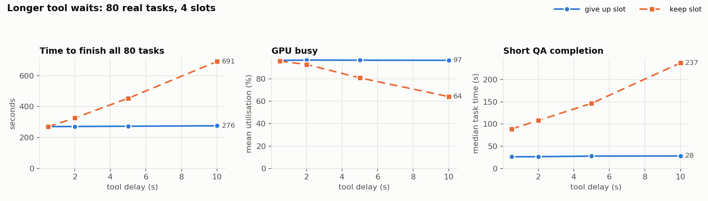
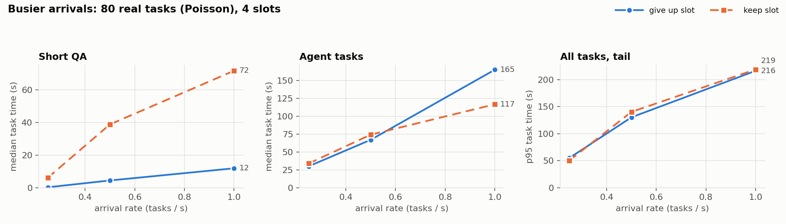
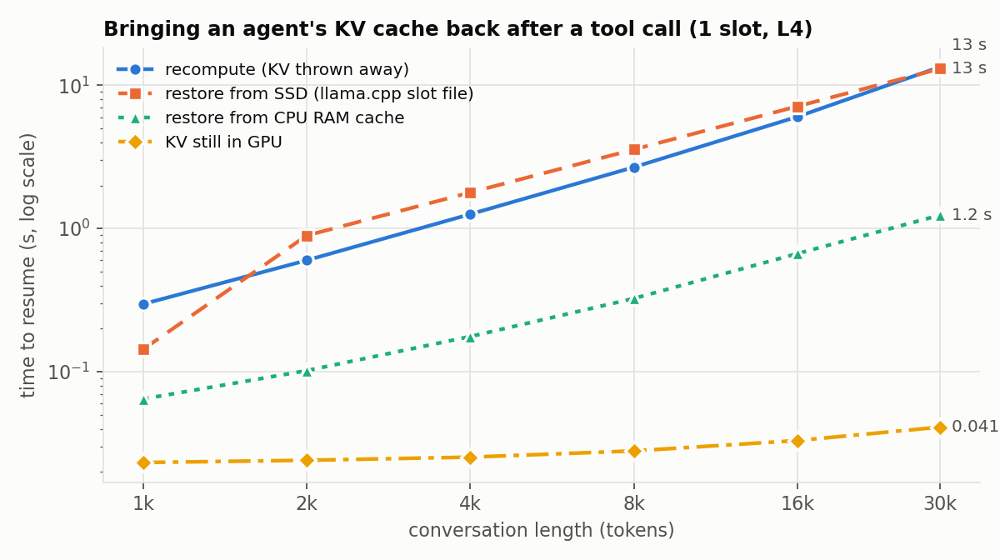

# Memory-aware scheduling for agent workloads on llama.cpp

CSE 291 (LLM Systems) project.

**The question:** when many tasks share one GPU, and some of them are agents that
pause to call tools, how should we decide who runs next and what to keep in GPU
memory, so that more tasks finish without running out of memory?

- **Phase 1:** measure two simple first-come-first-served (FIFO) schedulers
  and find what slows them down.
- **Phase 2:** build one smarter, memory-aware scheduler based on what Phase 1 shows.

## Status

- **Done:**
  - two FIFO schedulers and a runner that replays a workload and records timing,
    memory, and outputs
  - an 80-task real workload with correct answers, plus scoring
  - full runs of that workload on AWS, plus sweeps over slot count, context
    length, tool delay, and arrival rate
  - memory experiments: CPU RAM cache, SSD save/restore, 8-bit KV, shared KV pool
  - plots ([results/plots/](results/plots/)) and a one-row-per-run summary
    ([results/runs_summary.csv](results/runs_summary.csv))
  - a revised v2 task collection and a [60-task Qwen validation](results/validation_v2_60/README.md)
    with 60/60 workflows completed; its strict multistep accuracy was 13/30
  - a repeatable [Phase 1 FIFO protocol](docs/phase1_protocol.md) with a fresh
    server for each run, fixed `NP` during a `K` sweep, and per-type reporting
  - the [18-run controlled v2 core matrix](results/phase1_v2_batch/) with raw
    request, task, quality, and memory measurements
  - an [audit of the earlier v1 sweeps](docs/v1_sweep_audit.md), including
    scorer checks and limits on what their plots establish
- **Not done yet:**
  - 4-bit KV and a too-small RAM cache (`bash scripts/sweep.sh extra`, queued)
  - repeat runs of the sweeps (each sweep config ran once)
  - the remaining controlled v2 sweeps, a narrative Phase 1 report, and the
    Phase 2 scheduler

## Controlled v2 core results (snapshot: 2026-11-04 21:44 UTC)

The AWS g6.xlarge checkout at source commit `ef0473f` ran the
[Phase 1 experiment matrix](docs/phase1_experiment_matrix.md). The paired
preflight completed **60/60 tasks under each FIFO with no failures**. The
**18/18 core runs** are now complete: three repeats of each FIFO at K=1, 2,
and 4, always with `NP=4`, `CTX=16384`, no RAM cache, and the same 60-task
batch. All **1,080 task executions** completed with no task failures or context
truncations. The report verified matching offered-task, prediction, and task
IDs in each run and matching workload, model, and runtime hashes across runs.

| Scheduler | K | Median completed tasks/s | Median task p50 / p95 | Median peak GPU memory | Median automatic correctness |
|---|---:|---:|---:|---:|---:|
| Request FIFO | 1 | 0.135 | 187 / 439 s | 5,921 MiB | 33/50 |
| Task FIFO | 1 | 0.091 | 130 / 589 s | 5,917 MiB | 31/50 |
| Request FIFO | 2 | 0.155 | 145 / 384 s | 5,923 MiB | 33/50 |
| Task FIFO | 2 | 0.166 | 79 / 321 s | 5,917 MiB | 32/50 |
| Request FIFO | 4 | 0.324 | 73 / 184 s | 5,925 MiB | 31/50 |
| Task FIFO | 4 | 0.255 | 54 / 210 s | 5,917 MiB | 31/50 |

These are medians across three runs per setting. Request FIFO led on
throughput at K=1 and K=4; task FIFO led slightly at K=2. Task FIFO had a
lower median task latency at every K, while its p95 was worse at K=1 and K=4.
The 50 judged tasks are 20 QA plus 30 multistep; 10 writing tasks per run still
need human or semantic judgment. About 66–82 intermediate agent calls per run
hit their output limit, and generated-token totals varied across settings, so
the low exact-answer scores and output lengths need attention before claiming
a quality-neutral speedup. See the [raw runs](results/raw/) and
[core CSVs and curves](results/phase1_v2_batch/).

Because the team account has a **$20 daily AWS limit**, the outer launch shell
remains suspended. The additional 56 arrival, delay, context, output-length,
and cache runs have **not** started. The core process has finished, but the EC2
instance and llama-server were still running at this snapshot and continue to
bill until the instance is stopped.

The raw data and generated report are now in this repository. The instance log
remains at `/home/ec2-user/phase1-launch.log`. To regenerate the report, run
`python -m analysis.phase1_report --prefix phase1_v2_batch --out results/phase1_v2_batch`
and `python -m analysis.phase1_core_plots --report results/phase1_v2_batch`.

Setup: AWS g6.xlarge (one NVIDIA L4, 24 GB), llama.cpp `llama-server` built with
CUDA, model Qwen2.5-7B-Instruct (4-bit, Q4_K_M). Setup steps are in
[setup/README.md](setup/README.md).

## Key ideas

- **Model call:** one request to the LLM ("read this, answer that").
- **Tool call:** the agent asks for outside data (for example sales rows or a log
  file), and waits about 2 s for it. The GPU isn't needed during the wait.
- **Agent task:** model call → tool call → model call → ... Each model call sees the
  whole conversation so far, so the context keeps growing.
- **KV cache:** the model's memory of the text it has already read. With the KV
  cache, the model doesn't have to re-read the conversation. Without it, the model
  must **recompute** (re-read everything), which costs GPU time. For this model the
  KV cache takes about 56 KB per token.
- **Slots:** we start llama.cpp with `-np 4`, which creates 4 slots. Each slot has
  its own piece of GPU memory for KV cache (`CTX=16384` total / 4 = 4,096 tokens
  per slot). llama.cpp runs all busy slots together in one batch. **We choose the
  number of slots** with the flag. **Our scheduler chooses which request goes into
  a free slot.** All slot memory is reserved at startup, so GPU memory stays flat
  (about 5.9 GB) no matter what runs.
- **K:** how many things our scheduler lets in at once. For now `K = 4 = slots`.

## The two FIFO schedulers

Both serve requests in arrival order. They differ in **what happens to an agent's
slot while it waits for a tool.** (Code: [scheduler/fifo.py](scheduler/fifo.py).)

| | `fifo_request`: give up the slot | `fifo_task`: keep the slot |
|---|---|---|
| What waits in line | each model call separately | whole tasks |
| During a tool wait | the slot goes to the next request in line | the slot stays reserved for the agent, and sits idle |
| Agent's KV cache | gets **overwritten** by the next request, so it must be recomputed when the agent returns | stays in GPU memory, so nothing is recomputed |
| Good for | short tasks (they get a slot quickly), and GPU throughput | agent tasks |
| Bad for | agent tasks (they recompute and wait in line again) | short tasks (they wait behind idle agents), and GPU throughput |

**llama.cpp's RAM cache.** `--cache-ram 8192` gives llama.cpp up to 8 GB of CPU
RAM. Before overwriting a slot, llama.cpp copies the old KV cache there, and it
copies it back to the GPU when that conversation returns. Copying is much cheaper
than recomputing. llama.cpp does this automatically; our scheduler doesn't control
it. We test both settings:
- **GPU-only** (`--cache-ram 0`): overwritten KV cache is lost.
- **RAM cache** (`--cache-ram 8192`): overwritten KV cache is saved to CPU RAM.

## Workload: 80 real tasks

These are real tasks with known correct answers, so we can check that a faster
setup isn't producing worse answers. Files are in
[workloads/tasks/v1/](workloads/tasks/v1/), and details are in
[workloads/README.md](workloads/README.md).
The v1 results below use this original collection. The revised
[v2 collection](workloads/tasks/v2/README.md) clarifies answer formats and
output allowances and should be named separately in future comparisons.

| Type | Tasks | What it is | What it stresses |
|---|---:|---|---|
| Short QA | 20 | short passage + question (from SQuAD) | small input, short answer |
| Long-context QA | 10 | find one field in a 1.8k–3.4k-token document | large input |
| Long generation | 10 | write an explanation or story (200–600 words) | long output |
| Multi-step agent | 40 | sales, logs, documents, inventory; 2, 4, or 7 tool calls each | tool waits, growing context |
| **Total** | **80** | 252 model calls, 172 tool calls | |

Each multi-step task follows a fixed script, `model → tool result → model → ... →
final JSON answer`, with a 2 s delay per tool. Tool results are fixed data, so
every run sees exactly the same inputs.

**Scoring** ([evaluation/](evaluation/)):
- **QA:** exact match with the correct answer.
- **Multi-step:** the final JSON must match exactly.
- **Long generation:** for now we only check that it finished and hit the word
  range. Rubric grading comes later.
- A task only counts as correct if it **fully finished**. Failed or cut-off tasks
  count as wrong.

There is also an older synthetic generator, [workloads/generate.py](workloads/generate.py),
which uses filler text with approximate input lengths and forced output limits. It's useful for sweeps
(for example "make every context 8k tokens"), but has no right answers.

## Results so far

### 80-task runs (all tasks arrive at once, 4 slots, 16k total context)

| | GPU-only, give up slot | same, repeated | GPU-only, keep slot | RAM cache, give up slot | RAM cache, keep slot |
|---|---:|---:|---:|---:|---:|
| Finished | 80/80 | 80/80 | 80/80 | 80/80 | 80/80 |
| Total time | 257 s | 277 s | 340 s | 251 s | 337 s |
| Tokens generated per second | 117 | 106 | 87 | 118 | 86 |
| Agent context recomputed after a tool call | 91% | 91% | 0% | 13% | 0% |
| Short QA, median time | 25 s | 27 s | 112 s | 28 s | 111 s |
| Multi-step, median time | 196 s | 216 s | 164 s | 207 s | 161 s |
| GPU memory | 5.9 GB | 5.9 GB | 5.9 GB | 5.9 GB | 5.9 GB |
| CPU RAM used by server | 0.9 GB | 0.9 GB | 0.9 GB | 5.4 GB | 5.7 GB |
| Short QA correct | 19/20 | 19/20 | 19/20 | 19/20 | 19/20 |
| Long-context QA correct | 9/10 | 9/10 | 9/10 | 9/10 | 9/10 |
| Multi-step correct | 9/40 | 9/40 | 10/40 | 12/40 | 12/40 |
| Writing within word range | 1/10 | 3/10 | 2/10 | 3/10 | 4/10 |

**What this tells us:**

1. **Giving up the slot keeps the GPU busier.** It generates about 117 tokens/s,
   vs 87 when agents keep their slot. When an agent holds a slot during a tool
   wait, the GPU works on fewer requests at once and produces fewer tokens per
   second.
2. **But giving up the slot throws away agent context.** With 80 tasks waiting,
   the slot is always taken by the time the tool returns, so 91% of the agent's
   earlier conversation has to be recomputed.
3. **llama.cpp's RAM cache fixes most of that.** Recompute drops from 91% to 13%,
   at a cost of about 4.5 GB of extra CPU RAM. Total speed barely changes, because
   these contexts are short (1–3k tokens), so recompute is still cheap. It should
   matter more with longer contexts (the next sweep).
4. **Keeping the slot helps agents but hurts short tasks.** Multi-step tasks
   finish faster, but short questions wait about 4× longer.
5. **Automatic quality checks show a serious baseline limitation.**
   - All 30 QA response texts were identical across these five runs (28 correct).
   - Multi-step exact scores ranged from 9–12/40. Six individual tasks changed
     correctness between the two repeats of the same request-FIFO setup.
   - The first run had 124 output-limit stops in intermediate agent calls and 9
     in final agent calls; 13 final answers were not valid JSON. Low accuracy
     cannot be attributed solely to arithmetic or to scheduling.
   - Only 1–4/10 writing responses met the required word range; writing
     semantics were not judged. Generated output totals ranged from 29,105 to
     30,133 tokens (3.4% relative to the largest), so compare actual output
     lengths alongside speed.
6. **One repeated setup changed total time by 7.6%** (257 vs 277 s). The other
   cells need repeats before small speed differences can be trusted.

**A measured trade-off:** what to do with an agent's KV cache while it waits for a
tool.
- Keeping it in GPU memory wastes the slot.
- Throwing it away wastes compute on recomputing it.
- Saving it to CPU RAM costs host memory.

The Phase 2 scheduler will make this choice for each tool wait (keep, move to
CPU/SSD, or drop), and decide which tasks to let in based on how much KV memory
is free.

### Earlier pilot (30 synthetic tasks)

Same 4 slots. 26/30 tasks finished in every setup. The 4 failures were
long-context prompts longer than a 4,096-token slot (rejected with HTTP 400), not
out-of-memory errors. It showed the same pattern: short tasks are faster when
agents give up their slot, and agents are faster when they keep it. These runs
were done before we started restarting the server between runs, so the
keep-slot runs started with a warm cache. Treat them as rough.

## Sweeps

The server was restarted before every saved sweep run. Most settings ran once,
so these plots show observed trends without uncertainty intervals. The slot
sweep changes both scheduler concurrency and server KV allocation; the older
synthetic context generator also changed other prompt text as document size
changed. Read the [v1 sweep audit](docs/v1_sweep_audit.md) before treating a
curve as a controlled effect. Every run finished every task except the 16k
split-KV run noted below. Numbers come from
[results/runs_summary.csv](results/runs_summary.csv).

### More slots and server capacity (80 real tasks, 4,096 KV tokens per slot)

Here `K=NP` and total `CTX=4096×NP`, so the number of slots and allocated KV
memory grow together. The controlled v2 core matrix holds `NP` and `CTX` fixed
while changing K.



| Slots | Tokens/s, give up slot | Tokens/s, keep slot | GPU memory |
|---|---:|---:|---:|
| 2 | 81 | 59 | 5.5 GB |
| 4 | 108 | 91 | 5.9 GB |
| 8 | 137 | 114 | 6.8 GB |
| 16 | 196 | 139 | 8.6 GB |

- **More slots increased throughput in these four measured settings.** The GPU
  batches more requests together. At 16 slots the run used about 8.6 GB of
  GPU memory and had no memory failure for this v1 workload; longer contexts
  could behave differently.
- **Giving up the slot is 20–40% faster at every slot count.**
- **Keeping the slot made short-question median completion time about 3.8–4.7×
  longer** across these slot counts.
- With more slots, a returning agent more often finds its old slot still free, so
  recompute drops from 91% (4 slots) to 56% (16 slots).

### Longer agent context (synthetic: 15 agents + 25 short questions, 4 slots)

Agents start from a document generated at a nominal size of 1k, 4k, or 12k
tokens, then make 4 tool calls. Measured median initial agent prompts were
about 0.98k, 3.50k, and 10.13k tokens. The same generator seed kept the task
types fixed, but changing document size also changed most other task and tool
text; this is not a paired size-only experiment.



| Nominal agent document | Give up slot | Keep slot | Give up slot + RAM cache |
|---|---:|---:|---:|
| 1k tokens | 84 s | 85 s | **59 s** |
| 4k tokens | 149 s | 101 s | **80 s** |
| 12k tokens | **352 s** | 146 s | 144 s |

(Time to finish all 40 tasks.)

- **The nominal 12k run shows a large reversal:** request FIFO took 352 s
  versus 146 s for task FIFO, with nearly all carried-over context recomputed.
  Because other prompt text changed, this is suggestive rather than an isolated
  estimate of the effect of document length.
- **The RAM-cache request run combined low recomputation with short-question
  responsiveness** in this synthetic mix. At nominal 12k it reached **8.9 GB
  server RSS** with an 8 GB cache budget; more cached contexts could cause
  evictions or host-memory pressure.

### Longer tool waits (80 real tasks, 4 slots)



| Tool wait | Give up slot | Keep slot | GPU busy (keep slot) |
|---|---:|---:|---:|
| 0.5 s | 271 s | 270 s | 96% |
| 2 s | 271 s | 326 s | 93% |
| 5 s | 273 s | 454 s | 81% |
| 10 s | 276 s | **691 s** | 64% |

- When agents give up their slot, other requests use it during tool waits; the
  measured makespan stayed near 271–276 s across these wait settings.
- When agents keep their slot, it sits idle for the whole wait. At 10 s waits
  everything takes 2.5× longer and the GPU is idle about a third of the time.

### Busier arrivals (80 real tasks arriving randomly, 4 slots)



- At the lowest offered rate, overall median task times were 17 s versus 21 s;
  the short-question medians still differed (0.3 s versus 6.2 s).
- As load grows, keeping the slot makes short questions wait 6–9× longer (72 s vs
  12 s at 1 task/s), while agent tasks finish faster (117 s vs 165 s).

### Memory options (80 real tasks, 8 slots, give up slot)

| Setup | Finished | Time | GPU memory | Automatic quality check |
|---|---:|---:|---:|---|
| 32k tokens split 8 ways (normal) | 80/80 | 210 s | 6.8 GB | 28/30 QA, 9/40 multistep |
| 16k tokens split 8 ways (2k per slot) | **73/80** | 198 s | 5.9 GB | 7 long documents rejected |
| 16k tokens as one shared pool (`--kv-unified`) | 80/80 | 221 s | 5.9 GB | 28/30 QA, 9/40 multistep |
| 32k tokens, 8-bit KV (`-ctk q8_0 -ctv q8_0`) | 80/80 | 224 s | 6.0 GB | 28/30 QA, 13/40 multistep |

- **A shared KV pool completed all tasks with a smaller total CTX allocation**
  and about 0.9 GB less observed GPU memory. Its 221 s versus 210 s is a
  single-run comparison.
- **8-bit KV used about 0.9 GB less GPU memory** than the standard 32k run.
  QA scores matched, while multistep scores differed; the single runs do not
  establish whether compression changed answer quality.
- The 16k-split run rejected **7 long-context tasks with HTTP 400**, so its
  198 s makespan is not comparable to an 80/80 completion run.

### Bringing KV back after a tool call (microbenchmark, 1 slot)



| Way to resume a 30k-token conversation | Time |
|---|---:|
| KV still in GPU | 0.04 s |
| Restore from CPU RAM (llama.cpp cache) | 1.2 s |
| Restore from SSD (llama.cpp slot file, EBS or local NVMe) | 13 s |
| Recompute from scratch | 14.8 s |

- The KV cache is about **57 KB per token** (1.7 GB for 30k tokens).
- **RAM is about 12× faster than recompute.**
- **SSD restore took about 13 s**, close to recomputation at roughly 13–15 s,
  on both EBS and local NVMe. The effective rate was about 132 MB/s for a 1.72
  GB slot file. This test does not isolate disk I/O from llama.cpp loading and
  memory-copy costs.

## Provisional Phase 1 lessons from v1

The completed v1 sweeps show a trade-off between reusing an agent's context and
freeing its slot during a tool wait. The table describes the observed direction
of the single-run comparisons, not a tuned policy choice for every workload.
The 12k synthetic inputs were not paired across document sizes, and the new v2
matrix will test these patterns with stronger controls.

| Situation | Favorable choice in these runs | Observed reason |
|---|---|---|
| Short context | give up the slot | recompute is cheap; the slot keeps working |
| Nominal 12k context, 2 s wait | keep the slot | request FIFO made 40 tasks take 352 s versus 146 s for task FIFO in the synthetic run |
| 10 s tool wait with v1 tasks | give up the slot | task FIFO took 691 s versus 276 s for request FIFO |
| Long context with RAM cache | give up the slot with RAM cache | the nominal 12k RAM-cache run took 144 s; 30k-token RAM restore was faster than recompute in the microbenchmark |

Raising slots and total KV allocation together improved throughput in the
measured 2–16 slot range. The v1 runs do not establish the point at which
additional slots stop helping or exhaust memory.

**Phase 2 plan:** at each tool call, decide whether to **keep** the KV in GPU,
**move** it to CPU RAM or SSD, or **drop** it and recompute later, based on
context size, expected tool wait, and free memory. Admit new tasks based on how
much KV memory is free rather than a fixed slot count, and give returning agents
priority so long tasks aren't starved. Compare against both FIFO schedulers and
the best tuned fixed setup (more slots, shared KV pool, 8-bit KV).

## How to run (on the GPU machine)

To reproduce the **older v1 experiments** summarized above:

```bash
bash setup/setup_node.sh                 # one-time: build llama.cpp, download model
SMOKE=1 bash scripts/quality.sh          # 20-task quick check, ~2 min
K=4 CTX=16384 bash scripts/quality.sh    # full 80-task runs (4 setups + 1 repeat), ~30 min
bash scripts/pilot.sh                    # 30-task synthetic pilot
bash scripts/sweep.sh slots              # one sweep group: slots|ctx|delay|kv|rate|extra|micro
```

Run all sweeps in the background (they survive a dropped SSH session; finished
runs are skipped if you start again):

```bash
nohup bash -c 'for g in slots ctx delay kv rate extra micro; do bash scripts/sweep.sh $g; done' > sweep.log 2>&1 &
```

Summarize and plot (works on a laptop once results are pulled):

```bash
python -m analysis.summarize      # results/runs_summary.csv
python -m analysis.plots          # results/plots/*.png
```

For the **controlled v2 comparison**, generate the fixed 60-task subset with
`python -m scripts.select_validation`, inspect the matrix with
`python -m scripts.phase1_fifo --workload workloads/generated/validation_v2_60.jsonl --prefix phase1_v2_batch --dry-run`,
then execute without `--dry-run`. See the [full protocol](docs/phase1_protocol.md)
for controls and metric definitions. The [experiment matrix](docs/phase1_experiment_matrix.md)
lists the additional context, delay, output-length, arrival-rate, and cache
sweeps and their reporting commands.

The scripts restart the server before each run, so no run gets another run's
warm cache. **Stop the EC2 instance when you're done.**

Check the task files and scorers locally (no GPU needed):

```bash
python -m workloads.validate_collection
python -m unittest discover -s tests -v
```

## Output files

Each run writes a folder in [results/raw/](results/raw/):

| File | What's in it |
|---|---|
| `summary.json` | headline numbers: finished/failed, latency percentiles, throughput, cache hit rate, peak memory |
| `tasks.csv` | one row per task: total time, time waiting in line, time in model, time in tools |
| `requests.csv` | one row per model call: wait, time to first token, tokens recomputed vs reused from cache, slot used |
| `memory.csv` | GPU memory and server CPU RAM, sampled every 100 ms |
| `metrics.csv` | llama-server's own counters, every 1 s |
| `outputs.jsonl`, `predictions.jsonl` | the model's actual answers |
| `quality/` | scores (from `python -m evaluation.score_run --run results/raw/<name>`) |
| `config.json` | exact settings used for the run |
| `deployment.json` | model/runtime/workload checksums and cache procedure for controlled v2 runs |

## Repository map

| Path | What it is |
|---|---|
| [setup/](setup/) | build llama.cpp, download model, start server, smoke test |
| [workloads/tasks/v1/](workloads/tasks/v1/) | the 80 real tasks and their answers |
| [workloads/tasks/v2/](workloads/tasks/v2/) | revised executable definitions and references |
| [workloads/](workloads/) | task builders and validators, synthetic generator, `export_v1.py` (converts the 80 tasks for the runner) |
| [scheduler/fifo.py](scheduler/fifo.py) | the two FIFO schedulers |
| [runner/](runner/) | sends tasks to llama.cpp and records everything |
| [evaluation/](evaluation/) | scoring for QA, multi-step, and long generation |
| [scripts/](scripts/) | `quality.sh` (80-task runs), `sweep.sh` (all sweeps), `kv_microbench.py` (KV restore timing), `pilot.sh` (synthetic pilot) |
| [analysis/](analysis/) | `summarize.py` (one row per run), `plots.py` (figures) |
| [tests/](tests/) | unit tests for task data and scorers |
| [results/](results/) | raw run data, `runs_summary.csv`, `plots/` |
