# Phase 1 measurements and interpretation

This page preserves the detailed run notes and plots previously in the root README. For the experiment setup and metric definitions, see [the Phase 1 protocol](phase1_protocol.md).

## Controlled v2 core results (snapshot: 2026-11-04 21:44 UTC)

The AWS g6.xlarge checkout at source commit `ef0473f` ran the
[Phase 1 experiment matrix](phase1_experiment_matrix.md). The paired
preflight completed **60/60 tasks under each FIFO with no failures**. The
**18/18 core runs** are now complete: three repeats of each FIFO at K=1, 2,
and 4, always with `NP=4`, `CTX=16384`, no RAM cache, and the same 60-task
batch. All **1,080 task executions** completed with no task failures or context
truncations. The report verified matching offered-task, prediction, and task
IDs in each run and matching workload, model, and runtime hashes across runs.

| Scheduler | K | Median completed tasks/s | Median task p50 / p95 | Median peak GPU memory | Median automatic correctness |
|---|---:|---:|---:|---:|---:|
| Request FIFO | 1 | 0.135 | 187 / 439 s | 5,921 MiB | 33/50 |
| Task FIFO | 1 | 0.091 | 130 / 589 s | 5,917 MiB | 31/50 |
| Request FIFO | 2 | 0.155 | 145 / 384 s | 5,923 MiB | 33/50 |
| Task FIFO | 2 | 0.166 | 79 / 321 s | 5,917 MiB | 32/50 |
| Request FIFO | 4 | 0.324 | 73 / 184 s | 5,925 MiB | 31/50 |
| Task FIFO | 4 | 0.255 | 54 / 210 s | 5,917 MiB | 31/50 |

These are medians across three runs per setting. Request FIFO led on
throughput at K=1 and K=4; task FIFO led slightly at K=2. Task FIFO had a
lower median task latency at every K, while its p95 was worse at K=1 and K=4.
The 50 judged tasks are 20 QA plus 30 multistep; 10 writing tasks per run still
need human or semantic judgment. About 66–82 intermediate agent calls per run
hit their output limit, and generated-token totals varied across settings, so
the low exact-answer scores and output lengths need attention before claiming
a quality-neutral speedup. See the [raw runs](../results/raw/) and
[core CSVs and curves](../results/phase1_v2_batch/).

### Controlled v2 core curves and current takeaway

In the first four plots, shaded ranges show the minimum and maximum across the
three repeats at each setting. `K` is the scheduler limit; the server stayed at
four slots and 16,384 total context tokens in every run.

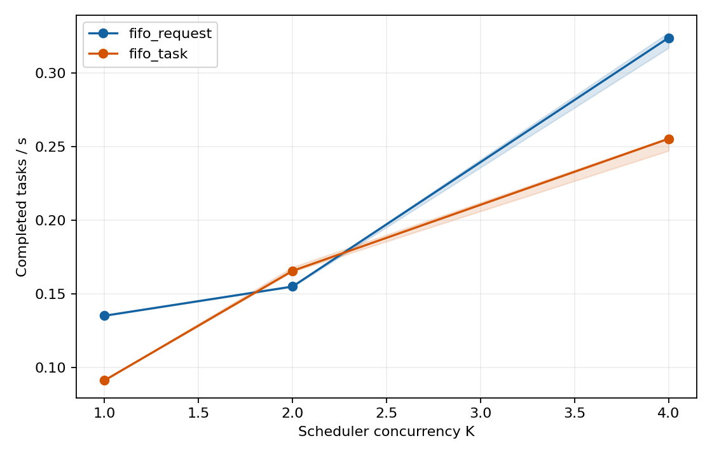

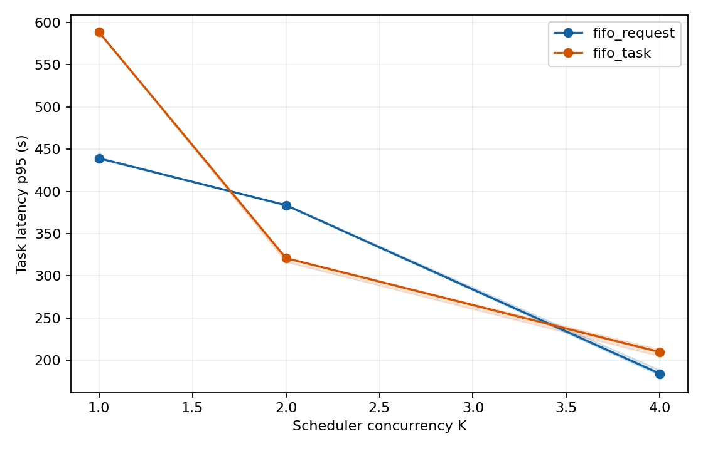

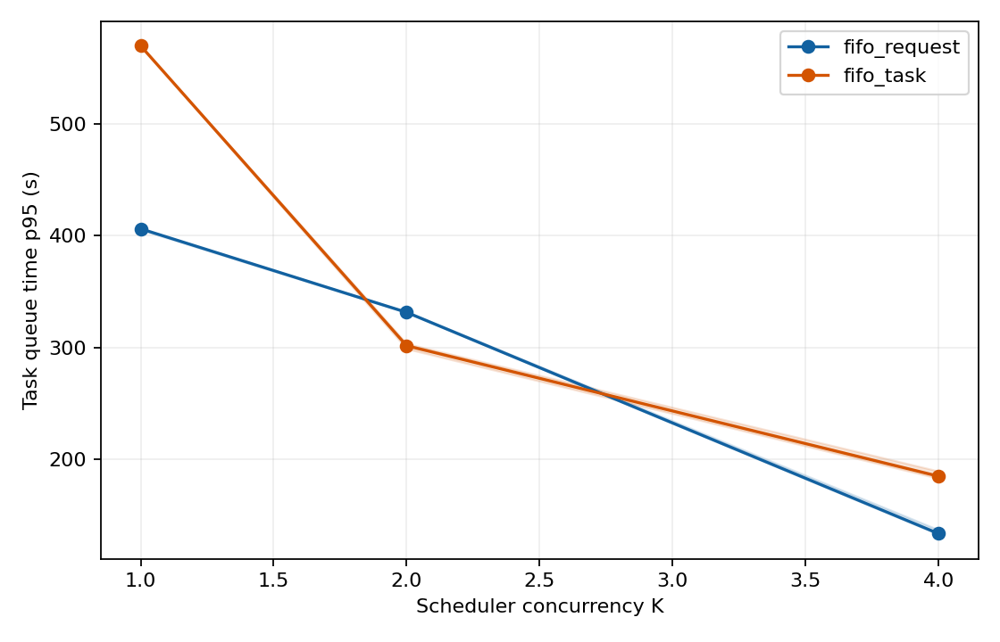

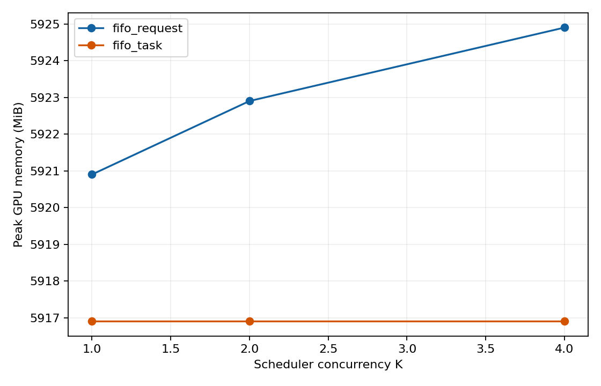

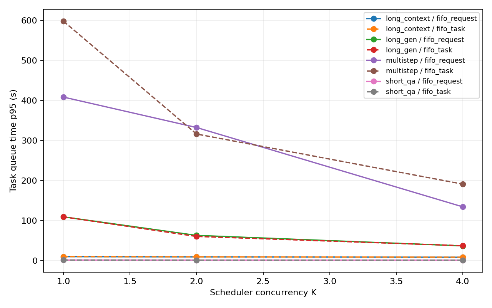

The main finding so far is that raising `K` from 1 to 4 increased completed
tasks/s for both FIFOs, but the preferable FIFO depends on `K` and the metric.
At K=4, request FIFO completed about 27% more tasks/s than task FIFO (0.324
versus 0.255), while task FIFO had a lower median task latency (54 versus 73 s)
and a higher p95 (210 versus 184 s). At K=2, task FIFO was about 7% ahead on
throughput and had lower median and p95 task latency. The multistep tasks had
much higher queue p95 than short QA in this batch; the task ordering and policy
both need examination before calling this scheduler starvation.

Peak GPU memory remained near 5,920 MiB across all K values because the
server's four slots and total KV allocation were fixed. These core runs show a
scheduling trade-off under comfortable memory use; they do not yet identify a
memory-pressure threshold or prove a memory-aware policy will help. The
context and RAM-cache sweeps are intended to test that. Automatic correctness
was only 31–33/50 judged tasks per run, with writing still unjudged and many
intermediate output-limit stops, so the speed comparisons are not yet evidence
of equal task quality.

Other core plots: [median task latency](../results/phase1_v2_batch/latency_p50_s.png),
[generated tokens/s](../results/phase1_v2_batch/generated_tokens_per_s.png),
[server RSS](../results/phase1_v2_batch/peak_server_rss_mib.png),
[completion rate](../results/phase1_v2_batch/completion_rate.png),
[failure rate](../results/phase1_v2_batch/failure_rate.png), and
[context truncations](../results/phase1_v2_batch/context_truncations.png).

### Controlled v2 follow-up sweeps

The launcher finished all **56/56** additional runs on November 4 at
**7:21 pm Pacific**: 12 tool-delay, 12 arrival-rate, 12 context-length,
12 response-length, and 8 RAM-cache runs. There were **2,880/2,880 completed
task executions**, zero model-request failures, zero context truncations, and
zero forced short outputs. Each configuration has two repeats and both FIFOs.
The reports validated complete policy pairs and matching model, llama.cpp, and
source checksums. The synthetic context/output workloads have no reference
accuracy score; fixed-v2 runs scored 30--34/50 judged tasks, depending on the
run, with ten writing tasks still awaiting semantic judgment.

| Controlled change | Median result and interpretation |
|---|---|
| Tool wait, 0 to 8 s | Task FIFO throughput fell from 0.245 to 0.081 tasks/s, while request FIFO stayed near 0.155--0.159. At 8 s, task p95 was 643 s versus 374 s for request FIFO. Holding an idle slot becomes costly. |
| Steady arrival, 0.25 to 1 task/s | Request FIFO throughput rose from 0.148 to 0.190 tasks/s, while p95 latency rose from 199 to 269 s. Task FIFO went from 0.139 to 0.164 tasks/s, with p95 rising from 167 to 271 s. The offered arrival span affects throughput. |
| Paired initial document, nominal 500 to 2,500 tokens | Request FIFO throughput fell from 0.281 to 0.191 tasks/s; task FIFO fell from 0.238 to 0.209. At 2,500 tokens task FIFO led, consistent with higher recomputation cost for released contexts. |
| Forced output, 32 to 512 tokens | Both FIFOs moved from about 2.8 to 0.191 tasks/s; task p95 rose from about 13.5 to 199 s. Every run generated exactly 40 times the requested token count and had no short output. |
| Host RAM cache, 0 to 8,192 MiB | Request FIFO throughput improved from 0.150 to 0.174 tasks/s and p95 fell from 398 to 343 s. Server RSS rose from about 873 to 4,821 MiB. Task FIFO changed little because it already retained its slot. |

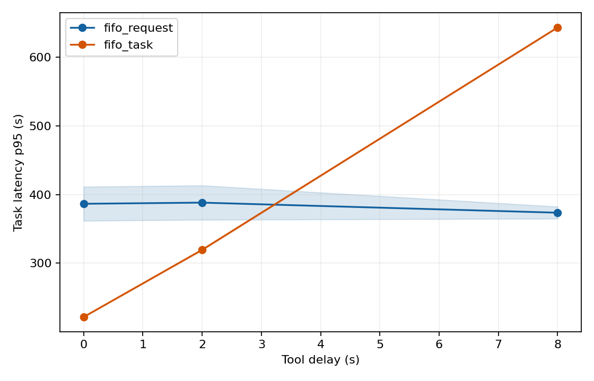

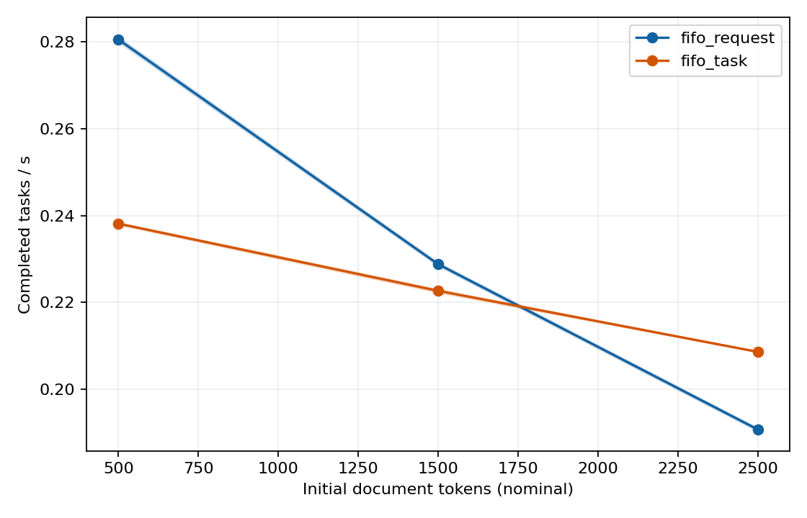

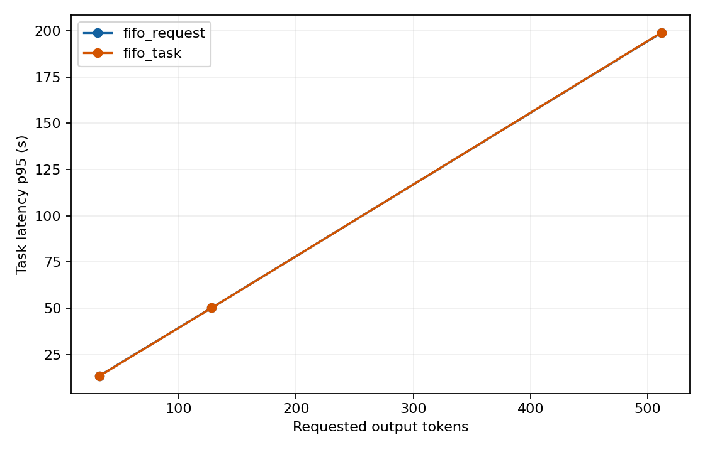

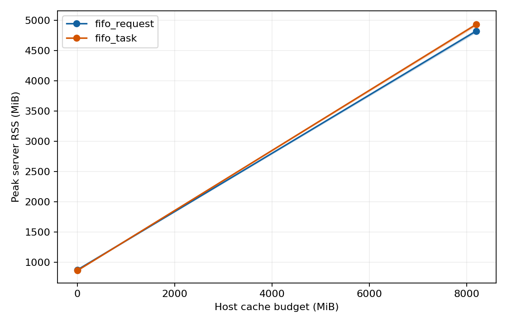

The [arrival-rate throughput curve](../results/phase1_rate/throughput_completed_tasks_s.png)
and each group's additional latency, queue, throughput, memory, completion,
failure, and truncation curves are in the linked report directories above.
Computed/cached prompt-token totals and per-type metrics are in each group's
runs.csv and types.csv.

These results identify a **trade-off between recomputing context, holding idle
slots, and spending host RAM**. They do not yet show GPU memory exhaustion:
peak GPU use stayed near 5,907--5,925 MiB because server slots and total
context allocation were fixed. A memory-aware policy should be selected from
the measured context, delay, and cache effects, then tested against tuned FIFO
baselines under a tighter memory budget. The synthetic sweeps test serving
cost, not answer quality. Intermediate output-limit stops and low multistep
correctness in the fixed workload remain visible limitations.

The raw data and reports are in this repository. The runs used an AWS
g6.xlarge (one NVIDIA L4, 24 GB), llama.cpp `llama-server` built with
CUDA, model Qwen2.5-7B-Instruct (4-bit, Q4_K_M). Setup steps are in
[setup/README.md](../setup/README.md).

## Results so far

### 80-task runs (all tasks arrive at once, 4 slots, 16k total context)

| | GPU-only, give up slot | same, repeated | GPU-only, keep slot | RAM cache, give up slot | RAM cache, keep slot |
|---|---:|---:|---:|---:|---:|
| Finished | 80/80 | 80/80 | 80/80 | 80/80 | 80/80 |
| Total time | 257 s | 277 s | 340 s | 251 s | 337 s |
| Tokens generated per second | 117 | 106 | 87 | 118 | 86 |
| Agent context recomputed after a tool call | 91% | 91% | 0% | 13% | 0% |
| Short QA, median time | 25 s | 27 s | 112 s | 28 s | 111 s |
| Multi-step, median time | 196 s | 216 s | 164 s | 207 s | 161 s |
| GPU memory | 5.9 GB | 5.9 GB | 5.9 GB | 5.9 GB | 5.9 GB |
| CPU RAM used by server | 0.9 GB | 0.9 GB | 0.9 GB | 5.4 GB | 5.7 GB |
| Short QA correct | 19/20 | 19/20 | 19/20 | 19/20 | 19/20 |
| Long-context QA correct | 9/10 | 9/10 | 9/10 | 9/10 | 9/10 |
| Multi-step correct | 9/40 | 9/40 | 10/40 | 12/40 | 12/40 |
| Writing within word range | 1/10 | 3/10 | 2/10 | 3/10 | 4/10 |

**What this tells us:**

1. **Giving up the slot keeps the GPU busier.** It generates about 117 tokens/s,
   vs 87 when agents keep their slot. When an agent holds a slot during a tool
   wait, the GPU works on fewer requests at once and produces fewer tokens per
   second.
2. **But giving up the slot throws away agent context.** With 80 tasks waiting,
   the slot is always taken by the time the tool returns, so 91% of the agent's
   earlier conversation has to be recomputed.
3. **llama.cpp's RAM cache fixes most of that.** Recompute drops from 91% to 13%,
   at a cost of about 4.5 GB of extra CPU RAM. Total speed barely changes, because
   these contexts are short (1–3k tokens), so recompute is still cheap. It should
   matter more with longer contexts (the next sweep).
4. **Keeping the slot helps agents but hurts short tasks.** Multi-step tasks
   finish faster, but short questions wait about 4× longer.
5. **Automatic quality checks show a serious baseline limitation.**
   - All 30 QA response texts were identical across these five runs (28 correct).
   - Multi-step exact scores ranged from 9–12/40. Six individual tasks changed
     correctness between the two repeats of the same request-FIFO setup.
   - The first run had 124 output-limit stops in intermediate agent calls and 9
     in final agent calls; 13 final answers were not valid JSON. Low accuracy
     cannot be attributed solely to arithmetic or to scheduling.
   - Only 1–4/10 writing responses met the required word range; writing
     semantics were not judged. Generated output totals ranged from 29,105 to
     30,133 tokens (3.4% relative to the largest), so compare actual output
     lengths alongside speed.
6. **One repeated setup changed total time by 7.6%** (257 vs 277 s). The other
   cells need repeats before small speed differences can be trusted.

**A measured trade-off:** what to do with an agent's KV cache while it waits for a
tool.
- Keeping it in GPU memory wastes the slot.
- Throwing it away wastes compute on recomputing it.
- Saving it to CPU RAM costs host memory.

The Phase 2 scheduler will make this choice for each tool wait (keep, move to
CPU/SSD, or drop), and decide which tasks to let in based on how much KV memory
is free.

### Earlier pilot (30 synthetic tasks)

Same 4 slots. 26/30 tasks finished in every setup. The 4 failures were
long-context prompts longer than a 4,096-token slot (rejected with HTTP 400), not
out-of-memory errors. It showed the same pattern: short tasks are faster when
agents give up their slot, and agents are faster when they keep it. These runs
were done before we started restarting the server between runs, so the
keep-slot runs started with a warm cache. Treat them as rough.

## Sweeps

The server was restarted before every saved sweep run. Most settings ran once,
so these plots show observed trends without uncertainty intervals. The slot
sweep changes both scheduler concurrency and server KV allocation; the older
synthetic context generator also changed other prompt text as document size
changed. Read the [v1 sweep audit](v1_sweep_audit.md) before treating a
curve as a controlled effect. Every run finished every task except the 16k
split-KV run noted below. Numbers come from
[results/runs_summary.csv](../results/runs_summary.csv).

### More slots and server capacity (80 real tasks, 4,096 KV tokens per slot)

Here `K=NP` and total `CTX=4096×NP`, so the number of slots and allocated KV
memory grow together. The controlled v2 core matrix holds `NP` and `CTX` fixed
while changing K.

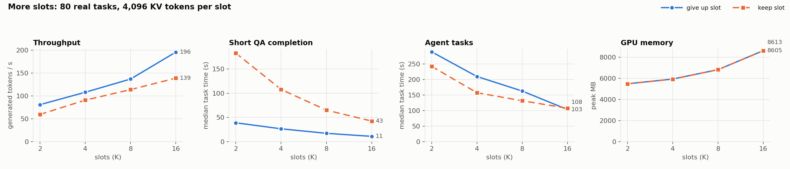

| Slots | Tokens/s, give up slot | Tokens/s, keep slot | GPU memory |
|---|---:|---:|---:|
| 2 | 81 | 59 | 5.5 GB |
| 4 | 108 | 91 | 5.9 GB |
| 8 | 137 | 114 | 6.8 GB |
| 16 | 196 | 139 | 8.6 GB |

- **More slots increased throughput in these four measured settings.** The GPU
  batches more requests together. At 16 slots the run used about 8.6 GB of
  GPU memory and had no memory failure for this v1 workload; longer contexts
  could behave differently.
- **Giving up the slot is 20–40% faster at every slot count.**
- **Keeping the slot made short-question median completion time about 3.8–4.7×
  longer** across these slot counts.
- With more slots, a returning agent more often finds its old slot still free, so
  recompute drops from 91% (4 slots) to 56% (16 slots).

### Longer agent context (synthetic: 15 agents + 25 short questions, 4 slots)

Agents start from a document generated at a nominal size of 1k, 4k, or 12k
tokens, then make 4 tool calls. Measured median initial agent prompts were
about 0.98k, 3.50k, and 10.13k tokens. The same generator seed kept the task
types fixed, but changing document size also changed most other task and tool
text; this is not a paired size-only experiment.

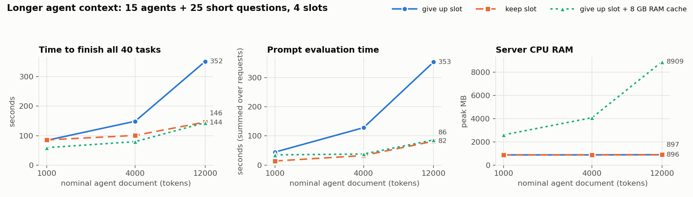

| Nominal agent document | Give up slot | Keep slot | Give up slot + RAM cache |
|---|---:|---:|---:|
| 1k tokens | 84 s | 85 s | **59 s** |
| 4k tokens | 149 s | 101 s | **80 s** |
| 12k tokens | **352 s** | 146 s | 144 s |

(Time to finish all 40 tasks.)

- **The nominal 12k run shows a large reversal:** request FIFO took 352 s
  versus 146 s for task FIFO, with nearly all carried-over context recomputed.
  Because other prompt text changed, this is suggestive rather than an isolated
  estimate of the effect of document length.
- **The RAM-cache request run combined low recomputation with short-question
  responsiveness** in this synthetic mix. At nominal 12k it reached **8.9 GB
  server RSS** with an 8 GB cache budget; more cached contexts could cause
  evictions or host-memory pressure.

### Longer tool waits (80 real tasks, 4 slots)

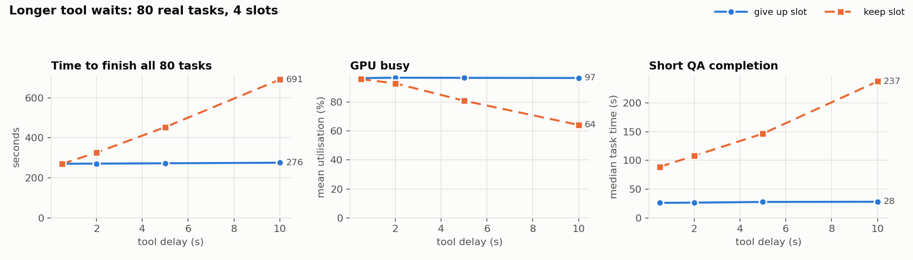

| Tool wait | Give up slot | Keep slot | GPU busy (keep slot) |
|---|---:|---:|---:|
| 0.5 s | 271 s | 270 s | 96% |
| 2 s | 271 s | 326 s | 93% |
| 5 s | 273 s | 454 s | 81% |
| 10 s | 276 s | **691 s** | 64% |

- When agents give up their slot, other requests use it during tool waits; the
  measured makespan stayed near 271–276 s across these wait settings.
- When agents keep their slot, it sits idle for the whole wait. At 10 s waits
  everything takes 2.5× longer and the GPU is idle about a third of the time.

### Busier arrivals (80 real tasks arriving randomly, 4 slots)

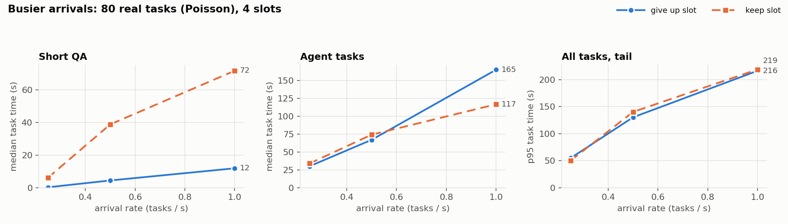

- At the lowest offered rate, overall median task times were 17 s versus 21 s;
  the short-question medians still differed (0.3 s versus 6.2 s).
- As load grows, keeping the slot makes short questions wait 6–9× longer (72 s vs
  12 s at 1 task/s), while agent tasks finish faster (117 s vs 165 s).

### Memory options (80 real tasks, 8 slots, give up slot)

| Setup | Finished | Time | GPU memory | Automatic quality check |
|---|---:|---:|---:|---|
| 32k tokens split 8 ways (normal) | 80/80 | 210 s | 6.8 GB | 28/30 QA, 9/40 multistep |
| 16k tokens split 8 ways (2k per slot) | **73/80** | 198 s | 5.9 GB | 7 long documents rejected |
| 16k tokens as one shared pool (`--kv-unified`) | 80/80 | 221 s | 5.9 GB | 28/30 QA, 9/40 multistep |
| 32k tokens, 8-bit KV (`-ctk q8_0 -ctv q8_0`) | 80/80 | 224 s | 6.0 GB | 28/30 QA, 13/40 multistep |

- **A shared KV pool completed all tasks with a smaller total CTX allocation**
  and about 0.9 GB less observed GPU memory. Its 221 s versus 210 s is a
  single-run comparison.
- **8-bit KV used about 0.9 GB less GPU memory** than the standard 32k run.
  QA scores matched, while multistep scores differed; the single runs do not
  establish whether compression changed answer quality.
- The 16k-split run rejected **7 long-context tasks with HTTP 400**, so its
  198 s makespan is not comparable to an 80/80 completion run.

### Bringing KV back after a tool call (microbenchmark, 1 slot)

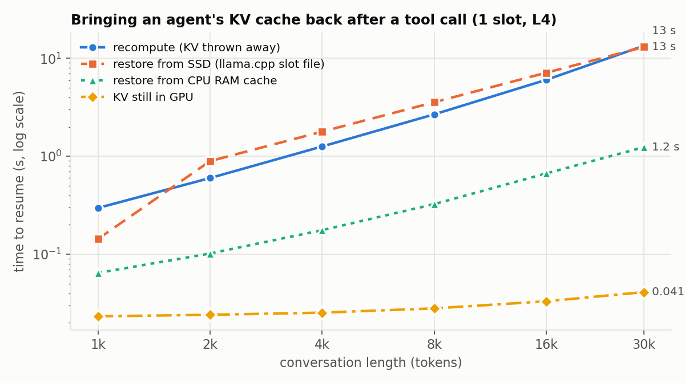

| Way to resume a 30k-token conversation | Time |
|---|---:|
| KV still in GPU | 0.04 s |
| Restore from CPU RAM (llama.cpp cache) | 1.2 s |
| Restore from SSD (llama.cpp slot file, EBS or local NVMe) | 13 s |
| Recompute from scratch | 14.8 s |

- The KV cache is about **57 KB per token** (1.7 GB for 30k tokens).
- **RAM is about 12× faster than recompute.**
- **SSD restore took about 13 s**, close to recomputation at roughly 13–15 s,
  on both EBS and local NVMe. The effective rate was about 132 MB/s for a 1.72
  GB slot file. This test does not isolate disk I/O from llama.cpp loading and
  memory-copy costs.

## Provisional Phase 1 lessons from v1

The completed v1 sweeps show a trade-off between reusing an agent's context and
freeing its slot during a tool wait. The table describes the observed direction
of the single-run comparisons, not a tuned policy choice for every workload.
The 12k synthetic inputs were not paired across document sizes; the controlled
v2 matrix above tests related patterns with stronger controls.

| Situation | Favorable choice in these runs | Observed reason |
|---|---|---|
| Short context | give up the slot | recompute is cheap; the slot keeps working |
| Nominal 12k context, 2 s wait | keep the slot | request FIFO made 40 tasks take 352 s versus 146 s for task FIFO in the synthetic run |
| 10 s tool wait with v1 tasks | give up the slot | task FIFO took 691 s versus 276 s for request FIFO |
| Long context with RAM cache | give up the slot with RAM cache | the nominal 12k RAM-cache run took 144 s; 30k-token RAM restore was faster than recompute in the microbenchmark |

Raising slots and total KV allocation together improved throughput in the
measured 2–16 slot range. The v1 runs do not establish the point at which
additional slots stop helping or exhaust memory.

**Phase 2 plan:** at each tool call, decide whether to **keep** the KV in GPU,
**move** it to CPU RAM or SSD, or **drop** it and recompute later, based on
context size, expected tool wait, and free memory. Admit new tasks based on how
much KV memory is free rather than a fixed slot count, and give returning agents
priority so long tasks aren't starved. Compare against both FIFO schedulers and
the best tuned fixed setup (more slots, shared KV pool, 8-bit KV).
