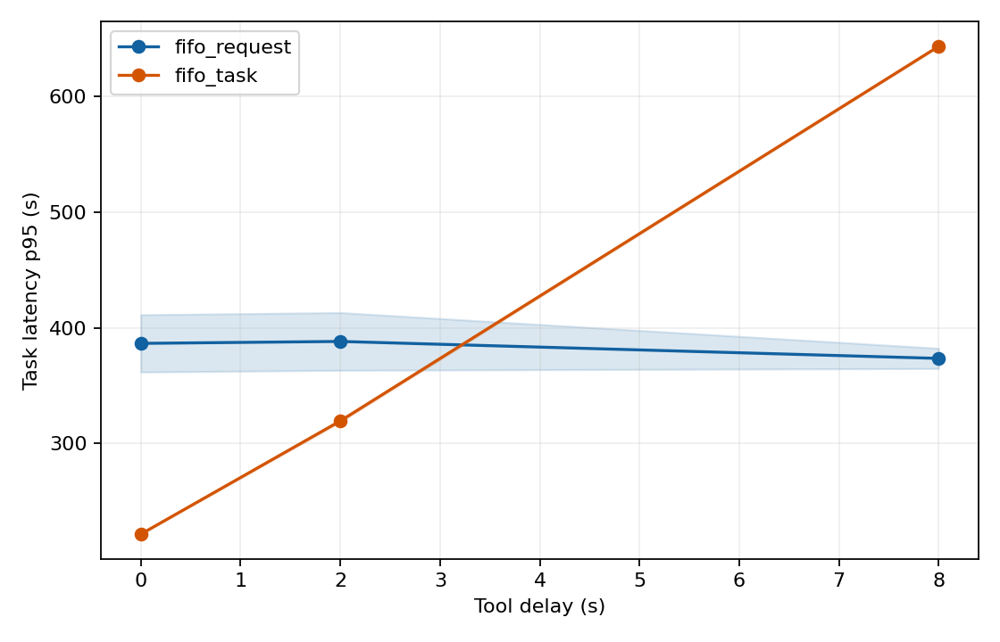
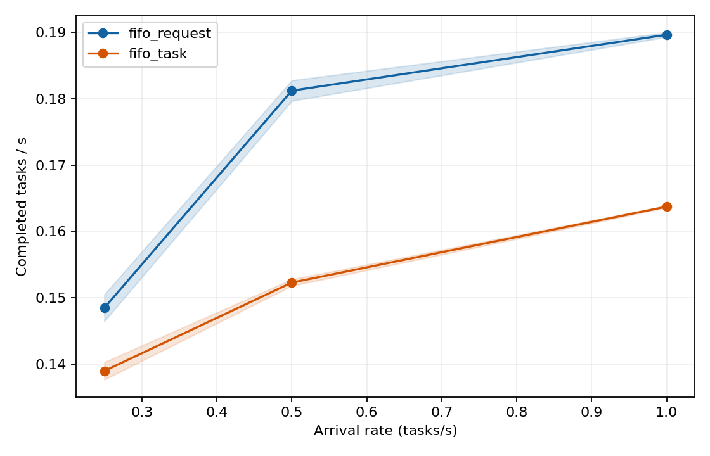
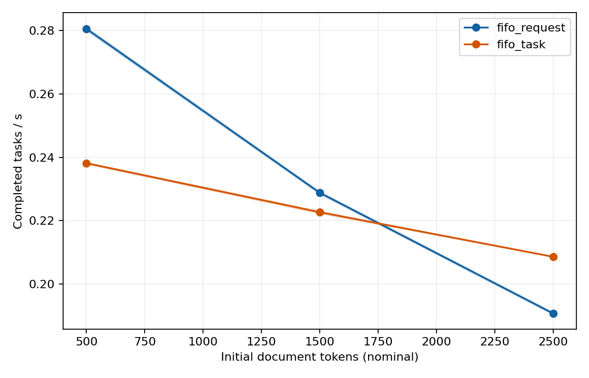
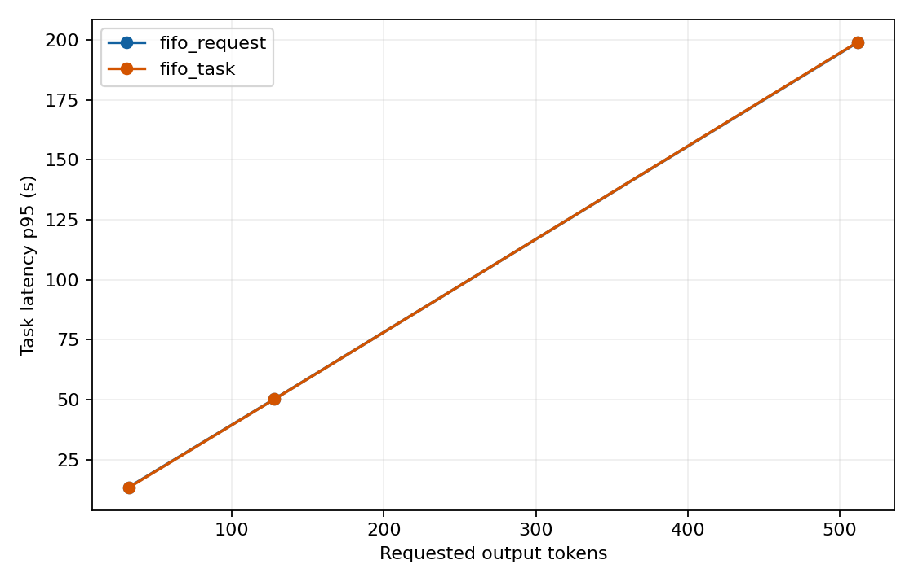
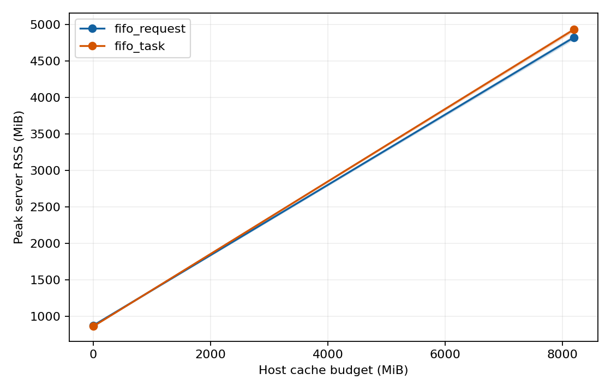

# Phase 1 follow-up sweeps: all 56 runs

This folder collects the five controlled Phase 1 follow-up sweep reports. The tables below use the checked-in `runs.csv` data; each setting has **two runs per FIFO**. Values in the main tables are medians over those two runs. The appendix lists every run individually. The original [raw run folders](../raw/) contain prompts, model responses, tool events, request/task timing, memory samples, quality records, and deployment checksums.

## Conditions and completeness

- Host: AWS g6.xlarge with one NVIDIA L4; model: Qwen2.5-7B-Instruct Q4_K_M through llama.cpp.
- Scheduler concurrency `K=2`, server slots `NP=4`, total server context `CTX=16384` in every follow-up run. The tested dimension changes within each sweep; other settings are held fixed within that sweep.
- The driver restarted llama-server for every policy/repeat and applied the same one-request warm-up. `deployment.json` in each raw folder records the exact workload, model, llama.cpp, and source checksums.
- 56 runs: 12 tool-delay, 12 arrival-rate, 12 context-length, 12 output-length, and 8 RAM-cache. All **2,880/2,880 offered task executions completed**. There were no model-request failures or context truncations.
- Fixed-v2 runs have 50 automatically judged QA/multistep tasks and 10 writing tasks per run. Writing semantic quality remains unjudged. Synthetic context/output sweeps have no reference accuracy score.

Throughput means completed tasks divided by timed replay makespan. Task p50/p95 is arrival-to-completion latency for completed tasks. Queue p95 includes task admission and model-request waits. Peak RSS is llama-server process RAM; sampled GPU memory is discussed below. Definitions and caveats are in the [Phase 1 protocol](../../docs/phase1_protocol.md).

## Tool delay sweep

**Workload:** 60 fixed v2 tasks. **Varied:** tool delay (seconds). **Runs:** 12.

| Tool delay | FIFO | Tasks/s | Task p50 (s) | Task p95 (s) | Queue p95 (s) | Peak server RSS (MiB) | Prompt computed / reused |
|---:|---|---:|---:|---:|---:|---:|---:|
| 0 | Request | 0.155 | 164.4 | 386.6 | 351.8 | 873 | 143,242 / 14,116 |
| 0 | Task | 0.245 | 75.6 | 221.8 | 210.0 | 861 | 52,864 / 105,236 |
| 2 | Request | 0.154 | 165.2 | 388.2 | 339.4 | 873 | 143,242 / 14,116 |
| 2 | Task | 0.167 | 77.6 | 319.6 | 301.0 | 860 | 52,786 / 104,670 |
| 8 | Request | 0.159 | 141.8 | 373.6 | 280.4 | 873 | 144,580 / 13,257 |
| 8 | Task | 0.081 | 84.3 | 643.1 | 599.9 | 860 | 52,803 / 105,063 |

**Interpretation:** A task-level reservation becomes costly when the agent waits for a tool. At 8 seconds, request FIFO completes about twice as many tasks per second and has a much lower p95 completion time.

All plots and per-run/per-type tables for this sweep are in [delay/](delay/): `runs.csv`, `types.csv`, `points.csv`, and ten PNG curves. The sweep uses 720 offered task executions, all completed.

## Steady arrival rate sweep

**Workload:** 60 fixed v2 tasks. **Varied:** steady arrival rate (tasks/s). **Runs:** 12.

| Steady arrival rate | FIFO | Tasks/s | Task p50 (s) | Task p95 (s) | Queue p95 (s) | Peak server RSS (MiB) | Prompt computed / reused |
|---:|---|---:|---:|---:|---:|---:|---:|
| 0.25 | Request | 0.148 | 34.4 | 198.9 | 157.4 | 874 | 137,550 / 20,837 |
| 0.25 | Task | 0.139 | 31.5 | 167.4 | 150.4 | 859 | 52,794 / 104,668 |
| 0.5 | Request | 0.181 | 78.8 | 240.6 | 197.8 | 874 | 139,872 / 16,820 |
| 0.5 | Task | 0.152 | 49.5 | 241.5 | 223.4 | 860 | 52,802 / 105,738 |
| 1 | Request | 0.190 | 89.1 | 269.2 | 224.0 | 873 | 143,064 / 13,617 |
| 1 | Task | 0.164 | 58.3 | 271.5 | 252.2 | 860 | 52,815 / 103,748 |

**Interpretation:** Faster arrivals raise throughput and increase queueing and tail latency. Throughput includes the time while tasks are still arriving, so it is not a pure GPU service-rate measure.

All plots and per-run/per-type tables for this sweep are in [rate/](rate/): `runs.csv`, `types.csv`, `points.csv`, and ten PNG curves. The sweep uses 720 offered task executions, all completed.

## Initial document length sweep

**Workload:** 40 paired synthetic three-step tasks. **Varied:** initial document length (nominal tokens). **Runs:** 12.

| Initial document length | FIFO | Tasks/s | Task p50 (s) | Task p95 (s) | Queue p95 (s) | Peak server RSS (MiB) | Prompt computed / reused |
|---:|---|---:|---:|---:|---:|---:|---:|
| 500 | Request | 0.281 | 118.7 | 139.7 | 129.7 | 865 | 83,447 / 2,671 |
| 500 | Task | 0.238 | 88.2 | 160.0 | 151.6 | 865 | 29,239 / 56,878 |
| 1500 | Request | 0.229 | 146.0 | 171.4 | 160.3 | 864 | 183,527 / 2,671 |
| 1500 | Task | 0.223 | 94.3 | 171.1 | 162.1 | 858 | 62,597 / 123,601 |
| 2500 | Request | 0.191 | 175.0 | 205.7 | 192.9 | 870 | 283,607 / 2,671 |
| 2500 | Task | 0.209 | 100.7 | 182.6 | 173.1 | 861 | 96,006 / 190,271 |

**Interpretation:** Request FIFO recomputes increasingly long prompts. Task FIFO reuses more prompt tokens and leads on throughput and p95 latency at 2,500 nominal document tokens.

All plots and per-run/per-type tables for this sweep are in [context/](context/): `runs.csv`, `types.csv`, `points.csv`, and ten PNG curves. The sweep uses 480 offered task executions, all completed.

## Forced response length sweep

**Workload:** 40 paired synthetic single-call tasks. **Varied:** forced response length (tokens). **Runs:** 12.

| Forced response length | FIFO | Tasks/s | Task p50 (s) | Task p95 (s) | Queue p95 (s) | Peak server RSS (MiB) | Prompt computed / reused |
|---:|---|---:|---:|---:|---:|---:|---:|
| 32 | Request | 2.808 | 7.5 | 13.6 | 12.9 | 854 | 2,212 / 988 |
| 32 | Task | 2.835 | 7.4 | 13.4 | 12.7 | 854 | 2,209 / 991 |
| 128 | Request | 0.757 | 27.8 | 50.3 | 47.7 | 854 | 2,212 / 988 |
| 128 | Task | 0.758 | 27.7 | 50.3 | 47.6 | 853 | 2,209 / 991 |
| 512 | Request | 0.191 | 109.7 | 199.0 | 188.5 | 856 | 2,212 / 988 |
| 512 | Task | 0.191 | 109.7 | 199.1 | 188.6 | 854 | 2,209 / 991 |

**Interpretation:** Decoding dominates as output length grows. The policies are nearly identical because these tasks have no tool waits or returning model steps.

Each run produced exactly 40 times the requested output length: 1,280, 5,120, or 20,480 generated tokens. There were no forced short outputs.

All plots and per-run/per-type tables for this sweep are in [output/](output/): `runs.csv`, `types.csv`, `points.csv`, and ten PNG curves. The sweep uses 480 offered task executions, all completed.

## Host RAM cache budget sweep

**Workload:** 60 fixed v2 tasks. **Varied:** host ram cache budget (MiB). **Runs:** 8.

| Host RAM cache budget | FIFO | Tasks/s | Task p50 (s) | Task p95 (s) | Queue p95 (s) | Peak server RSS (MiB) | Prompt computed / reused |
|---:|---|---:|---:|---:|---:|---:|---:|
| 0 | Request | 0.150 | 168.5 | 397.8 | 347.8 | 873 | 144,603 / 13,634 |
| 0 | Task | 0.166 | 78.8 | 321.2 | 302.4 | 861 | 52,788 / 104,420 |
| 8192 | Request | 0.174 | 142.8 | 343.1 | 300.5 | 4821 | 54,982 / 103,218 |
| 8192 | Task | 0.164 | 80.8 | 327.3 | 309.2 | 4930 | 52,106 / 105,446 |

**Interpretation:** With 8,192 MiB of host cache, request FIFO computes far fewer prompt tokens and improves throughput, while peak server RSS rises by about 4 GiB. Task FIFO changes little.

All plots and per-run/per-type tables for this sweep are in [cache/](cache/): `runs.csv`, `types.csv`, `points.csv`, and ten PNG curves. The sweep uses 480 offered task executions, all completed.

## Run-by-run index

This table shows the individual runs behind the medians. Each run name links to its complete raw folder, including `summary.json`, `deployment.json`, `tasks.csv`, `requests.csv`, `memory.csv`, `quality.jsonl`, and the original outputs.

| Sweep | Setting | Run | Offered/completed | Tasks/s | Task p95 (s) | Queue p95 (s) | Correct/judged | Peak GPU / server RSS (MiB) |
|---|---:|---|---:|---:|---:|---:|---:|---:|
| delay | 0 | [phase1_delay_0_r1_k2_fifo_request](../raw/phase1_delay_0_r1_k2_fifo_request/) | 60/60 | 0.165 | 361.8 | 325.9 | 32/50 | 5923 / 873 |
| delay | 0 | [phase1_delay_0_r1_k2_fifo_task](../raw/phase1_delay_0_r1_k2_fifo_task/) | 60/60 | 0.246 | 221.5 | 209.7 | 31/50 | 5917 / 861 |
| delay | 0 | [phase1_delay_0_r2_k2_fifo_request](../raw/phase1_delay_0_r2_k2_fifo_request/) | 60/60 | 0.145 | 411.3 | 377.7 | 32/50 | 5923 / 873 |
| delay | 0 | [phase1_delay_0_r2_k2_fifo_task](../raw/phase1_delay_0_r2_k2_fifo_task/) | 60/60 | 0.245 | 222.0 | 210.2 | 31/50 | 5917 / 861 |
| delay | 2 | [phase1_delay_2_r1_k2_fifo_request](../raw/phase1_delay_2_r1_k2_fifo_request/) | 60/60 | 0.144 | 413.2 | 365.3 | 32/50 | 5923 / 873 |
| delay | 2 | [phase1_delay_2_r1_k2_fifo_task](../raw/phase1_delay_2_r1_k2_fifo_task/) | 60/60 | 0.166 | 320.6 | 302.7 | 33/50 | 5917 / 860 |
| delay | 2 | [phase1_delay_2_r2_k2_fifo_request](../raw/phase1_delay_2_r2_k2_fifo_request/) | 60/60 | 0.164 | 363.3 | 313.4 | 32/50 | 5923 / 873 |
| delay | 2 | [phase1_delay_2_r2_k2_fifo_task](../raw/phase1_delay_2_r2_k2_fifo_task/) | 60/60 | 0.168 | 318.5 | 299.3 | 31/50 | 5917 / 860 |
| delay | 8 | [phase1_delay_8_r1_k2_fifo_request](../raw/phase1_delay_8_r1_k2_fifo_request/) | 60/60 | 0.163 | 364.8 | 272.7 | 32/50 | 5923 / 873 |
| delay | 8 | [phase1_delay_8_r1_k2_fifo_task](../raw/phase1_delay_8_r1_k2_fifo_task/) | 60/60 | 0.081 | 643.6 | 600.5 | 32/50 | 5917 / 860 |
| delay | 8 | [phase1_delay_8_r2_k2_fifo_request](../raw/phase1_delay_8_r2_k2_fifo_request/) | 60/60 | 0.156 | 382.3 | 288.1 | 33/50 | 5923 / 873 |
| delay | 8 | [phase1_delay_8_r2_k2_fifo_task](../raw/phase1_delay_8_r2_k2_fifo_task/) | 60/60 | 0.081 | 642.7 | 599.3 | 33/50 | 5917 / 860 |
| rate | 1 | [phase1_rate_100_r1_k2_fifo_request](../raw/phase1_rate_100_r1_k2_fifo_request/) | 60/60 | 0.190 | 268.6 | 223.5 | 31/50 | 5925 / 873 |
| rate | 1 | [phase1_rate_100_r1_k2_fifo_task](../raw/phase1_rate_100_r1_k2_fifo_task/) | 60/60 | 0.164 | 272.9 | 253.5 | 31/50 | 5917 / 860 |
| rate | 1 | [phase1_rate_100_r2_k2_fifo_request](../raw/phase1_rate_100_r2_k2_fifo_request/) | 60/60 | 0.189 | 269.8 | 224.5 | 31/50 | 5925 / 873 |
| rate | 1 | [phase1_rate_100_r2_k2_fifo_task](../raw/phase1_rate_100_r2_k2_fifo_task/) | 60/60 | 0.164 | 270.1 | 251.0 | 31/50 | 5917 / 861 |
| rate | 0.25 | [phase1_rate_25_r1_k2_fifo_request](../raw/phase1_rate_25_r1_k2_fifo_request/) | 60/60 | 0.146 | 209.0 | 168.7 | 30/50 | 5923 / 874 |
| rate | 0.25 | [phase1_rate_25_r1_k2_fifo_task](../raw/phase1_rate_25_r1_k2_fifo_task/) | 60/60 | 0.138 | 168.8 | 153.6 | 33/50 | 5917 / 859 |
| rate | 0.25 | [phase1_rate_25_r2_k2_fifo_request](../raw/phase1_rate_25_r2_k2_fifo_request/) | 60/60 | 0.150 | 188.7 | 146.2 | 32/50 | 5923 / 874 |
| rate | 0.25 | [phase1_rate_25_r2_k2_fifo_task](../raw/phase1_rate_25_r2_k2_fifo_task/) | 60/60 | 0.140 | 166.0 | 147.1 | 32/50 | 5917 / 859 |
| rate | 0.5 | [phase1_rate_50_r1_k2_fifo_request](../raw/phase1_rate_50_r1_k2_fifo_request/) | 60/60 | 0.183 | 237.6 | 192.7 | 32/50 | 5923 / 874 |
| rate | 0.5 | [phase1_rate_50_r1_k2_fifo_task](../raw/phase1_rate_50_r1_k2_fifo_task/) | 60/60 | 0.152 | 241.7 | 223.3 | 31/50 | 5917 / 860 |
| rate | 0.5 | [phase1_rate_50_r2_k2_fifo_request](../raw/phase1_rate_50_r2_k2_fifo_request/) | 60/60 | 0.180 | 243.6 | 202.9 | 33/50 | 5923 / 874 |
| rate | 0.5 | [phase1_rate_50_r2_k2_fifo_task](../raw/phase1_rate_50_r2_k2_fifo_task/) | 60/60 | 0.153 | 241.3 | 223.6 | 34/50 | 5917 / 859 |
| context | 1500 | [phase1_context_1500_r1_k2_fifo_request](../raw/phase1_context_1500_r1_k2_fifo_request/) | 40/40 | 0.228 | 171.8 | 160.6 | — | 5917 / 864 |
| context | 1500 | [phase1_context_1500_r1_k2_fifo_task](../raw/phase1_context_1500_r1_k2_fifo_task/) | 40/40 | 0.223 | 170.8 | 161.8 | — | 5917 / 858 |
| context | 1500 | [phase1_context_1500_r2_k2_fifo_request](../raw/phase1_context_1500_r2_k2_fifo_request/) | 40/40 | 0.229 | 171.1 | 160.0 | — | 5917 / 864 |
| context | 1500 | [phase1_context_1500_r2_k2_fifo_task](../raw/phase1_context_1500_r2_k2_fifo_task/) | 40/40 | 0.222 | 171.4 | 162.5 | — | 5917 / 858 |
| context | 2500 | [phase1_context_2500_r1_k2_fifo_request](../raw/phase1_context_2500_r1_k2_fifo_request/) | 40/40 | 0.190 | 206.2 | 193.4 | — | 5917 / 871 |
| context | 2500 | [phase1_context_2500_r1_k2_fifo_task](../raw/phase1_context_2500_r1_k2_fifo_task/) | 40/40 | 0.209 | 182.6 | 173.1 | — | 5917 / 861 |
| context | 2500 | [phase1_context_2500_r2_k2_fifo_request](../raw/phase1_context_2500_r2_k2_fifo_request/) | 40/40 | 0.191 | 205.2 | 192.4 | — | 5917 / 869 |
| context | 2500 | [phase1_context_2500_r2_k2_fifo_task](../raw/phase1_context_2500_r2_k2_fifo_task/) | 40/40 | 0.209 | 182.7 | 173.1 | — | 5917 / 860 |
| context | 500 | [phase1_context_500_r1_k2_fifo_request](../raw/phase1_context_500_r1_k2_fifo_request/) | 40/40 | 0.280 | 139.9 | 130.0 | — | 5917 / 865 |
| context | 500 | [phase1_context_500_r1_k2_fifo_task](../raw/phase1_context_500_r1_k2_fifo_task/) | 40/40 | 0.238 | 159.8 | 151.4 | — | 5925 / 863 |
| context | 500 | [phase1_context_500_r2_k2_fifo_request](../raw/phase1_context_500_r2_k2_fifo_request/) | 40/40 | 0.281 | 139.4 | 129.4 | — | 5917 / 865 |
| context | 500 | [phase1_context_500_r2_k2_fifo_task](../raw/phase1_context_500_r2_k2_fifo_task/) | 40/40 | 0.238 | 160.2 | 151.8 | — | 5925 / 867 |
| output | 128 | [phase1_output_128_r1_k2_fifo_request](../raw/phase1_output_128_r1_k2_fifo_request/) | 40/40 | 0.758 | 50.3 | 47.6 | — | 5907 / 854 |
| output | 128 | [phase1_output_128_r1_k2_fifo_task](../raw/phase1_output_128_r1_k2_fifo_task/) | 40/40 | 0.758 | 50.3 | 47.6 | — | 5907 / 853 |
| output | 128 | [phase1_output_128_r2_k2_fifo_request](../raw/phase1_output_128_r2_k2_fifo_request/) | 40/40 | 0.756 | 50.4 | 47.8 | — | 5907 / 854 |
| output | 128 | [phase1_output_128_r2_k2_fifo_task](../raw/phase1_output_128_r2_k2_fifo_task/) | 40/40 | 0.757 | 50.3 | 47.7 | — | 5907 / 853 |
| output | 32 | [phase1_output_32_r1_k2_fifo_request](../raw/phase1_output_32_r1_k2_fifo_request/) | 40/40 | 2.803 | 13.6 | 12.9 | — | 5907 / 854 |
| output | 32 | [phase1_output_32_r1_k2_fifo_task](../raw/phase1_output_32_r1_k2_fifo_task/) | 40/40 | 2.813 | 13.5 | 12.8 | — | 5907 / 852 |
| output | 32 | [phase1_output_32_r2_k2_fifo_request](../raw/phase1_output_32_r2_k2_fifo_request/) | 40/40 | 2.813 | 13.5 | 12.8 | — | 5907 / 854 |
| output | 32 | [phase1_output_32_r2_k2_fifo_task](../raw/phase1_output_32_r2_k2_fifo_task/) | 40/40 | 2.857 | 13.3 | 12.6 | — | 5911 / 856 |
| output | 512 | [phase1_output_512_r1_k2_fifo_request](../raw/phase1_output_512_r1_k2_fifo_request/) | 40/40 | 0.192 | 198.8 | 188.4 | — | 5907 / 856 |
| output | 512 | [phase1_output_512_r1_k2_fifo_task](../raw/phase1_output_512_r1_k2_fifo_task/) | 40/40 | 0.191 | 199.1 | 188.6 | — | 5907 / 854 |
| output | 512 | [phase1_output_512_r2_k2_fifo_request](../raw/phase1_output_512_r2_k2_fifo_request/) | 40/40 | 0.191 | 199.1 | 188.7 | — | 5907 / 856 |
| output | 512 | [phase1_output_512_r2_k2_fifo_task](../raw/phase1_output_512_r2_k2_fifo_task/) | 40/40 | 0.191 | 199.1 | 188.7 | — | 5907 / 854 |
| cache | 0 | [phase1_cache_0_r1_k2_fifo_request](../raw/phase1_cache_0_r1_k2_fifo_request/) | 60/60 | 0.144 | 411.8 | 364.1 | 32/50 | 5923 / 873 |
| cache | 0 | [phase1_cache_0_r1_k2_fifo_task](../raw/phase1_cache_0_r1_k2_fifo_task/) | 60/60 | 0.166 | 320.0 | 300.4 | 33/50 | 5917 / 860 |
| cache | 0 | [phase1_cache_0_r2_k2_fifo_request](../raw/phase1_cache_0_r2_k2_fifo_request/) | 60/60 | 0.155 | 383.8 | 331.5 | 33/50 | 5923 / 873 |
| cache | 0 | [phase1_cache_0_r2_k2_fifo_task](../raw/phase1_cache_0_r2_k2_fifo_task/) | 60/60 | 0.166 | 322.4 | 304.4 | 32/50 | 5917 / 861 |
| cache | 8192 | [phase1_cache_8192_r1_k2_fifo_request](../raw/phase1_cache_8192_r1_k2_fifo_request/) | 60/60 | 0.174 | 343.5 | 299.8 | 32/50 | 5917 / 4800 |
| cache | 8192 | [phase1_cache_8192_r1_k2_fifo_task](../raw/phase1_cache_8192_r1_k2_fifo_task/) | 60/60 | 0.164 | 327.1 | 308.9 | 31/50 | 5917 / 4951 |
| cache | 8192 | [phase1_cache_8192_r2_k2_fifo_request](../raw/phase1_cache_8192_r2_k2_fifo_request/) | 60/60 | 0.174 | 342.7 | 301.2 | 32/50 | 5917 / 4843 |
| cache | 8192 | [phase1_cache_8192_r2_k2_fifo_task](../raw/phase1_cache_8192_r2_k2_fifo_task/) | 60/60 | 0.163 | 327.5 | 309.5 | 33/50 | 5917 / 4909 |

## What these sweeps establish

The relative value of retaining an agent slot depends on tool wait and context length. Request FIFO uses waiting time to serve other work; task FIFO avoids more context recomputation. Host RAM caching reduces the recomputation cost for request FIFO at a substantial RAM cost. Output-heavy single-call work shows little scheduler difference.

Peak GPU use stayed near 5.9 GiB because server slots and total context allocation were fixed. These experiments characterize scheduling and cache behavior at comfortable GPU memory use; they do not locate an out-of-memory threshold. Each follow-up point has two repeats, and the synthetic sweeps do not measure answer correctness. The fixed-v2 runs also have pending writing judgment and substantial intermediate output-limit stops, so performance differences alone are not evidence of equal answer quality.

The 65 copied report files in this folder are the five sweeps' summary tables and curves. The 56 complete raw run directories remain under [`results/raw/`](../raw/) and are linked individually above; they are not duplicated here.

For the `K=1,2,4` core comparison and the earlier v1 exploratory runs, see [Phase 1 measurements](../../docs/phase1_results.md). For exact command lines and workload construction, see the [experiment matrix](../../docs/phase1_experiment_matrix.md).
